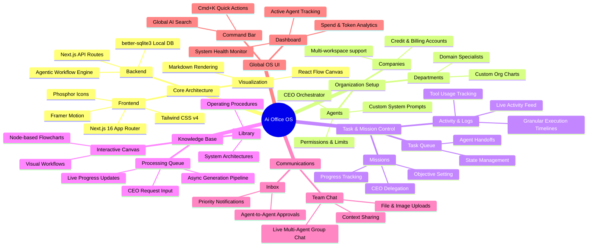

# Ai Office OS

Welcome to **Ai Office OS**, the premier autonomous agent control center. This platform serves as a virtual office where you can deploy, manage, and collaborate with specialized AI agents working alongside you.

## System Architecture & Features



## Tech Stack Highlights
- **Framework:** Next.js 16 (App Router)
- **Styling:** Tailwind CSS v4 + Framer Motion (Strict Dark Mode `zinc-950`)
- **Database:** Local, lightning-fast `better-sqlite3` database ensuring privacy and speed.
- **Diagrams:** `@xyflow/react` for interactive knowledge base canvases.
- **Icons:** Premium lightweight SVG icons via `@phosphor-icons/react`.

## Getting Started

1. **Install Dependencies:**
   ```bash
   npm install
   ```

2. **Run the Development Server:**
   ```bash
   npx next dev --webpack
   ```

3. **Access the OS:**
   Open `http://localhost:3000` to enter your Virtual Office and begin delegating tasks to your CEO.
