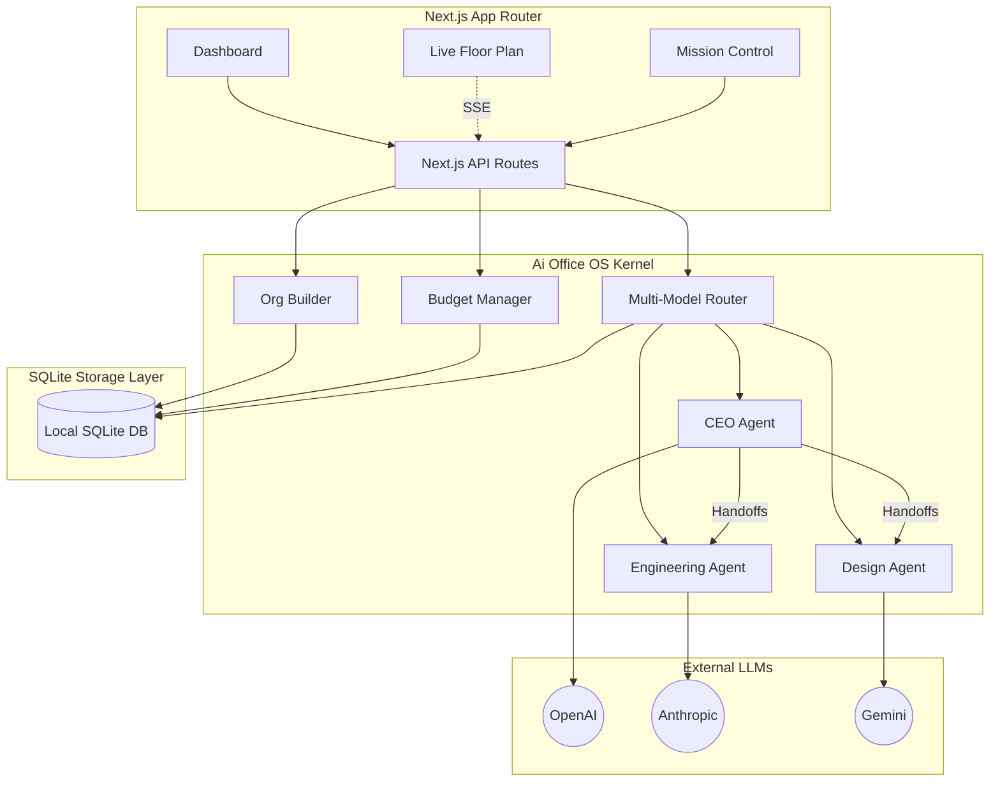

<div align="center">
  
  <h1 align="center">Ai Office OS</h1>
  <p align="center">
    <strong>The Operating System for Autonomous Multi-Agent Companies</strong>
  </p>
  <p align="center">
    <a href="#features">Features</a> •
    <a href="#architecture">Architecture</a> •
    <a href="#installation">Installation</a> •
    <a href="#demo">Demo</a>
  </p>
  <p align="center">
    
    
    
    
  </p>
</div>

<br/>

## 🚀 Overview

**Ai Office OS** is a premium, enterprise-grade platform for deploying, managing, and observing fleets of autonomous AI agents. 

Instead of simple chat interfaces, Ai Office OS provides a **Digital Company** experience. You define departments, assign agents specific roles and budgets, and watch them collaborate to complete complex missions on a live digital floor plan.

---

## ✨ Core Features

* 🏢 **Live Campus Simulator:** A real-time, glassmorphic 2D architectural blueprint tracking where your agents are physically "seated" based on their department, dynamically rendering their active/idle states.
* 🧠 **Multi-Model Routing:** Deploy a diverse workforce. Run an OpenAI `gpt-4o` CEO, an Anthropic `claude-3.5-sonnet` Senior Developer, and a Google `gemini-1.5-pro` Researcher—all in the same organization.
* 💸 **Compute Budget Engine:** Strict budget constraints at the agent level. Assign a `$25.00` budget to a marketing agent, and they will automatically pause operations when their API spend limit is reached.
* 📡 **Live Telemetry & Activity Feed:** Server-Sent Events (SSE) pipe agent thoughts, task completions, and location movements directly to your dashboard in real-time.
* 💾 **Persistent Corporate Memory:** Built on a highly-optimized SQLite WAL layer. Agents retain historical context across multiple missions.

<br/>

## 🏗 System Architecture



<br/>

## 💻 Installation & Setup

1. **Clone the repository**
   ```bash
   git clone https://github.com/himanshu-rag/ai-office-os.git
   cd ai-office-os
   ```

2. **Install dependencies**
   ```bash
   npm install
   ```

3. **Configure Environment Variables**
   Create a `.env.local` file in the root directory:
   ```env
   # LLM API Keys
   OPENAI_API_KEY=your_openai_key
   ANTHROPIC_API_KEY=your_anthropic_key
   GEMINI_API_KEY=your_gemini_key
   ```

4. **Initialize the Database & Start the Server**
   *(Note: You must run with the webpack flag to ensure proper SQLite compilation)*
   ```bash
   npm run dev -- --webpack
   ```

5. **Open the Dashboard**
   Navigate to [http://localhost:3000](http://localhost:3000)

<br/>

## 🎨 UI / UX Design

The platform was built with a strict **Ethereal Glassmorphism** design system. 
* Deep space backgrounds (`#030305`)
* Translucent frosted glass containers
* Beautiful micro-interactions powered by `framer-motion`
* High-contrast glowing accents for live agent telemetry

---

<div align="center">
  <p>Built for the IIT Delhi AI Showcase • 2026</p>
  <p>Released under the <a href="LICENSE">MIT License</a>.</p>
</div>
