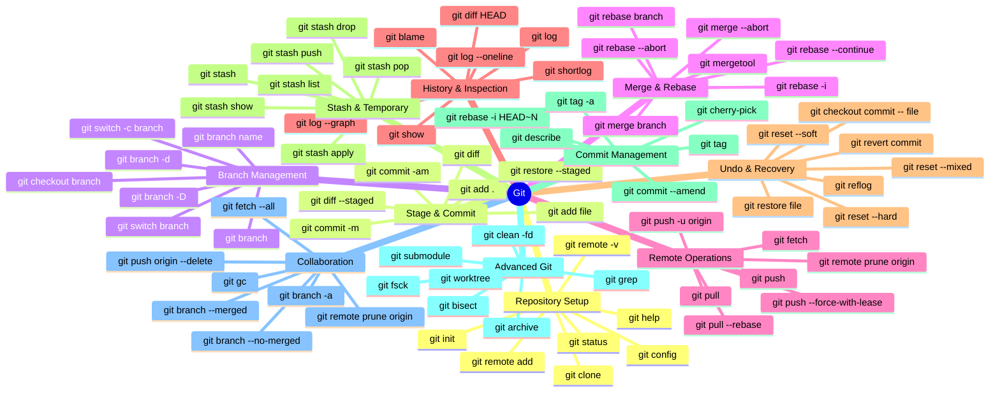

# Ai Office OS

Welcome to **Ai Office OS**, the premier autonomous agent control center. This platform serves as a virtual office where you can deploy, manage, and collaborate with specialized AI agents working alongside you.

## Features
- **CEO Agent Delegation:** Request workflows and operating procedures directly from your AI CEO.
- **Autonomous Activity:** Agents autonomously pick up tasks, execute them in real-time, and log their actions to the activity feed.
- **Interactive Org Charts & Knowledge Base:** Visualize your agent departments and seamlessly manage workflows via React Flow diagrams.
- **SQLite Local Database:** Fast, local, and secure state management using `better-sqlite3`.

---

## Git Command Mastery Guide

*As requested, here is the complete Data & AI Engineer Git Command Mastery workflow.*

## Tech Stack
- Next.js 16 (App Router)
- Tailwind CSS v4
- Framer Motion
- React Flow (`@xyflow/react`)
- Better SQLite3
